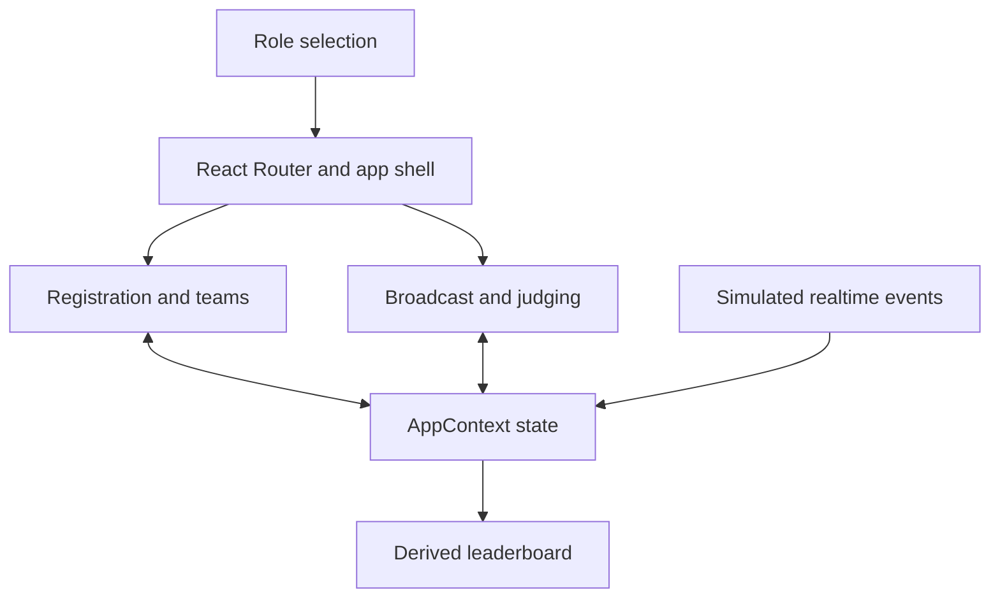

# EVENTOS

**One workspace for registration, team formation, broadcasts, judging, and event rankings.**


EVENTOS brings five event workflows into a React application built for Prompt Wars 2026. Shared state connects participant registration to matchmaking and connects judging scores to the leaderboard.

The repository implements an interactive frontend with seeded data and simulated realtime events. It does not include a persistent backend, server authentication, or a production event-management service.

## Modules

| Module | What the interface supports |
| --- | --- |
| Registration | Participant details, validation, generated check-in identifiers, and check-in state |
| Matchmaking | Ranked compatibility suggestions with explainable factors and team requests |
| Broadcasts | Announcements in a shared event feed |
| Judging | Submission assignments, rubric scores, and feedback |
| Leaderboard | Rankings derived from the current scoring state |

Participant, judge, and organizer personas change the workspace navigation. The selected role is stored locally; it is not an authenticated identity.

## Run

Use Node.js and npm:

```sh
git clone https://github.com/adeelfalaksher900-creator/smart-event-management-platform.git
cd smart-event-management-platform
npm install
npm run dev
```

Open **http://localhost:3000** and choose a role. Use fictional data when exploring registration and judging.

## Architecture



| Layer | Implementation |
| --- | --- |
| Interface | React 19, TypeScript, Tailwind CSS 4, Lucide, and Motion |
| Routing | React Router with lazy-loaded workspace pages |
| Charts | Recharts |
| State | React context and hooks with seeded records |
| Logic | Pure utilities for matching, validation, scoring, and ranking |
| Verification | TypeScript checking and Vitest |

Event records are held in memory and reset when the application reloads. `eventos_role` persists in localStorage until sign-out. The mock realtime hook emits predefined events; it is not a WebSocket connection.

## Matching and ranking

The matching function combines skill alignment (40 points), role complementarity (25), shared interests (20), experience compatibility (10), and a base collaboration factor (5). Suggestions include the factors that contributed to the score.

Leaderboard ordering uses score, judging coverage, and an alphabetical fallback. These are deterministic application rules, not a trained AI model.

## Checks

```sh
npm run lint
npm run test -- --run
npm run build
```

The `lint` command runs `tsc --noEmit`. Utility tests cover text escaping, URL checks, simulated rate limiting, role and assignment predicates, check-in payload structure, matching, scoring, ranking, and registration validation. Test definitions are in [src/utils/tests.test.ts](src/utils/tests.test.ts); these commands do not imply a newly verified passing result.

## Deployment

`npm run build` produces `dist/`. Serve it on a static host and configure unknown application paths to fall back to `index.html`, because the app uses browser-history routing.

The existing [.env.example](.env.example) contains `GEMINI_API_KEY` and `APP_URL` placeholders from the project scaffold. The inspected frontend workflow does not require those values. Keep any future service credentials on a backend.

## Security boundaries

Client-side role checks, assignment checks, URL validation, and text escaping support the interface, but cannot enforce authorization against an untrusted client. Generated `QR_HASH_` identifiers are formatting checks rather than cryptographically signed credentials. Real event operation would require server-side identity, authorization, durable storage, and audit records.

The repository does not establish an independent security audit or accessibility certification.

## Source map

| Path | Responsibility |
| --- | --- |
| `src/pages/` | Event workflows |
| `src/components/` | Shared controls and layout |
| `src/context/AppContext.tsx` | Shared records and mutations |
| `src/hooks/useMockRealtime.ts` | Predefined event simulation |
| `src/utils/` | Matching, scoring, ranking, validation, and tests |

## Contributions and license

Submit focused pull requests with relevant checks and a short description of the behavior changed. No license file is currently included.

